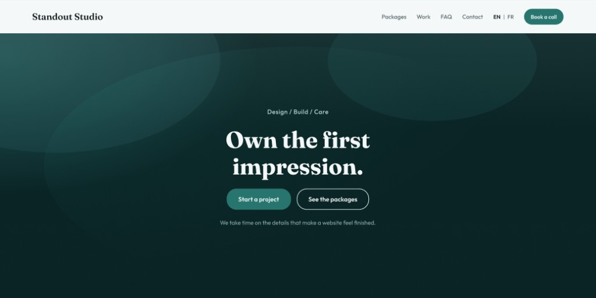

# Standout Studio

<p align="center">
  
</p>

Marketing site for Standout Studio, a bilingual web studio in Ottawa.

- Live site: [standoutstudio.ca](https://standoutstudio.ca)
- Design source: [Figma mockup](https://www.figma.com/design/nLEk8UpVUfFg1SsvmXmjnG)

## Stack

- [Next.js 16](https://nextjs.org) (App Router) and React 19
- [GSAP](https://gsap.com) with ScrollTrigger for motion, [Lenis](https://lenis.darkroom.engineering) for smooth scroll
- Plain CSS (`src/app/globals.css`), Archivo through `next/font`
- [Web3Forms](https://web3forms.com) for the contact form, [PostHog](https://posthog.com) for analytics
- Hosted on Vercel

## Getting started

```bash
npm install
npm run dev
```

Open [http://localhost:3000](http://localhost:3000).

## Environment

Copy `.env.example` to `.env.local` and fill in:

| Variable | Purpose |
| --- | --- |
| `NEXT_PUBLIC_SITE_URL` | Canonical site URL (defaults to `https://standoutstudio.ca`) |
| `NEXT_PUBLIC_WEB3FORMS_ACCESS_KEY` | Contact form delivery. Create a key with `standout.studio.ottawa@gmail.com` as the destination. The key is public by design (client-side submit). Without it, the form falls back to the visitor's mail app. |
| `NEXT_PUBLIC_POSTHOG_PROJECT_TOKEN` | PostHog project token (client-safe). Analytics are off when it is empty. |
| `NEXT_PUBLIC_POSTHOG_HOST` | PostHog API host, usually `https://us.i.posthog.com` (or `https://eu.i.posthog.com` for EU). |

On Vercel, add the same variables in Project Settings, Environment Variables.

## Scripts

| Command         | Purpose           |
| --------------- | ----------------- |
| `npm run dev`   | Local development |
| `npm run build` | Production build  |
| `npm run start` | Serve production  |
| `npm run lint`  | ESLint            |

## How it works

The whole site is **one persistent client app** mounted in the root layout. It owns the
page transitions (loader, iris between pages, menu, Work to case study), so it never
unmounts. It is still rendered on the server from the URL, so every page ships real HTML
in the right language.

The Next.js routes only declare which URLs exist and their metadata:

- `src/app/[[...slug]]` serves English at the root.
- `src/app/fr/[[...slug]]` serves French under `/fr`.
- `src/lib/seo.ts` holds titles, descriptions, canonical and hreflang tags, and the list of
  known paths (used by the sitemap and to answer 404 on anything else).

Inside the app, `src/site/router.js` handles navigation with `history.pushState`:

| Page | English | French |
| --- | --- | --- |
| Home | `/` | `/fr` |
| Work | `/work` | `/fr/work` |
| Case study | `/work/:slug` | `/fr/work/:slug` |
| Services | `/services` | `/fr/services` |
| About | `/about` | `/fr/about` |
| Contact | `/contact` | `/fr/contact` |
| Digital card | `/card` | `/fr/card` |

Old prototype anchors (`#realisations`, `#work-caramello-cafe`...) still land on the right page.

### Client area (hidden)

`/login` and `/account` exist but are turned off by `ACCOUNTS_ENABLED` in
`src/site/features.js` until the real backend is ready. While off, they answer 404 and stay
out of the sitemap and navigation. They run on a demo service (`src/site/auth/mockAuth.js`)
whose comments describe the API contract the backend should follow.

## Project structure

```
src/
  app/                  Next.js routes, metadata, sitemap, robots, icons, share images
    globals.css         All site styles and design tokens
  lib/                  Site config (site.ts), SEO (seo.ts), share image (og.tsx)
  components/seo/       JSON-LD
  proxy.ts              Sets the locale header for <html lang>
  instrumentation-client.ts  PostHog setup
  site/
    SiteRoot.jsx        Entry point: language, auth and the app
    App.jsx             Header, menu, loader, page transitions, smooth scroll
    router.js           URLs and in-app navigation
    i18n.jsx            All French and English copy
    projects.js         Client projects shown on Work and in case studies
    features.js         Feature flags
    motion.js           Shared easing and reveal helpers
    pages/              One file per page, plus shared pieces (Footer, DotEnd...)
    rb/                 Adapted React Bits effects (see LICENSE-react-bits.md)
    auth/               Demo client-area service
public/work/            Screenshots of client sites (WebP, 1200 px wide)
scripts/                Playwright helpers for capturing screenshots
```

## Common edits

- **Copy (FR and EN):** `src/site/i18n.jsx`. Page titles and descriptions for search engines
  live in `src/lib/seo.ts`.
- **Prices:** the packages in `src/site/i18n.jsx`, plus the starting price in `src/lib/seo.ts`
  and the share images (`src/app/opengraph-image.tsx`, `src/app/fr/opengraph-image.tsx`).
- **Add a project:** add an entry to `PROJECTS` in `src/site/projects.js` and a screenshot in
  `public/work/<slug>.webp`. Its case study page, sitemap entry and metadata follow
  automatically. On Work, projects alternate sides in the same layout.

## Design tokens

| Token | Value |
| --- | --- |
| Brume (light surface) | `#F3F5F4` |
| Pierre (soft panels) | `#E3E8E6` |
| Sarcelle (brand teal) | `#0F6B66` |
| Abysse (ink, dark surface) | `#0C2624` |
| Font | Archivo (variable width) |

The brand signature is the teal dot that ends headlines; the loader and page transitions
open from and close onto it. Motion respects `prefers-reduced-motion`.

## Collaboration

See [CONTRIBUTING.md](./CONTRIBUTING.md).

## License

See [LICENSE](./LICENSE). Proprietary. All rights reserved.
